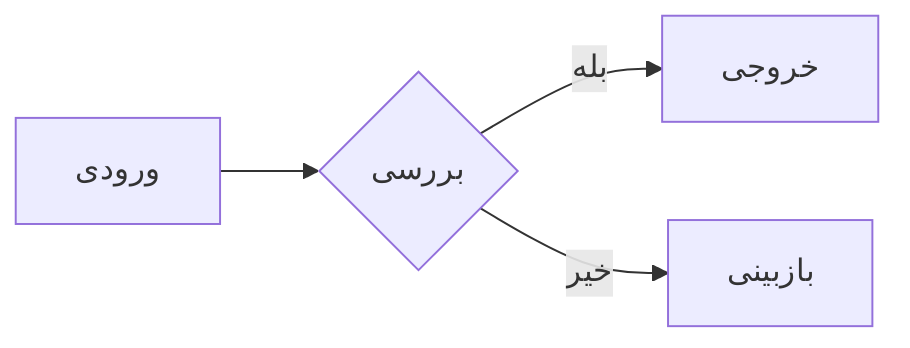

# خوانا | Khana Research Reader

**خوانا** یک نمایشگر سبک و راست‌چین برای مطالعه گزارش‌های پژوهشی و فایل‌های Markdown فارسی است. بدون بک‌اند، ثبت‌نام یا آپلود گزارش: فایل در مرورگر خودت پردازش می‌شود.

## شروع سریع

1. ریپو را Clone کن یا ZIP آن را دریافت کن.
2. `index.html` را با Chrome، Edge یا Firefox باز کن.
3. روی «بازکردن سند» کلیک کن یا فایل `.md` را روی صفحه رها کن.

```bash
git clone https://github.com/AmirAliRasoulii/khana.git
cd khana
xdg-open index.html
```

برای استفاده در DevTools می‌توانی `reader.js` را در **Sources → Snippets** اجرا کنی.

## قابلیت‌ها

- راست‌چین استاندارد برای متن فارسی و ایزوله‌سازی اصطلاحات فنی انگلیسی و اعداد.
- فهرست محتوا، Bookmark سرفصل‌ها، جست‌وجو با `Ctrl+K`، حالت تمرکز و عرض مطالعه.
- تم روشن/تاریک، تغییر اندازه قلم، نشانگر پیشرفت مطالعه، چاپ/PDF.
- جدول‌های واکنش‌گرا، وسط‌چین، با جهت خودکار هر سلول، کپی TSV و خروجی CSV.
- **Mermaid**: رندر فلوچارت، دیاگرام و نمودارهای Mermaid؛ نمایش سورس و دریافت SVG.
- **Chart.js**: پشتیبانی از نمودارهای اعلامی در بلوک‌های `chart` / `chartjs`، و دکمه «نمودار» برای جدول‌های عددی قابل تبدیل، بدون حدس داده.
- **ارجاعات**: نمایش خوانای نشانه‌های `cite`، `filecite`، `filenavlist`، `filesystem` و ارجاعات فایل‌های محلی، همراه با نمایه نوع و شناسه.
- favicon و لوگوتایپ ثابت خوانا؛ قابلیت تغییر لوگو از داخل رابط وجود ندارد.

## نمودارهای Mermaid

در فایل Markdown:

````md

````

## نمودار داده‌ای (Chart.js)

بلوک JSON با نوع `chart` / `chartjs`:

````md
```chart
{
  "type": "bar",
  "labels": ["هفته اول", "هفته دوم", "هفته سوم"],
  "datasets": [
    {"label": "درخواست‌ها", "data": [120, 175, 210]}
  ]
}
```
````

بلوک‌های Chart ساختاریافته ChatGPT از نوع `chartType`, `xKey`, `series`, `data` هم برای نمودارهای `bar`/`line`/`pie` پشتیبانی می‌شوند.

نوع‌های پذیرفته‌شده: `bar`, `line`, `pie`, `doughnut`, `radar`, `polararea`. فقط داده‌های JSON عددی اجرا می‌شوند؛ هیچ کد جاوااسکریپتی از سند اجرا نمی‌شود. جدول‌های عددی مناسب نیز می‌توانند به درخواست خواننده نمودار شوند.

## نکات و محدودیت‌ها

- برای بارگذاری کتابخانه‌های نمایش از CDN به اینترنت نیاز است؛ خود Markdown به سروری آپلود نمی‌شود.
- شناسه‌های داخلی ChatGPT مثل `turn...file...` یا مسیرهای `file://` و `sandbox:/` به‌خودی‌خود URL عمومی یا قابل دسترس مرورگر نیستند. «خوانا» آن‌ها را شماره‌گذاری و فهرست می‌کند، اما **لینک نامعتبر یا ساختگی تولید نمی‌کند**.
- برای نمودارهای Mermaid یا Chart.js در نبود اینترنت، سورس اصلی قابل مشاهده است.
- برای چاپ PDF، دکمه «PDF» را بزن و در مرورگر مقصد `Save as PDF` را انتخاب کن. اگر مرورگر Header/Footer خودش را افزود، گزینه **Headers and footers** را خاموش کن.
- فایل‌های گزارش خصوصی را در ریپوی عمومی Commit نکن.